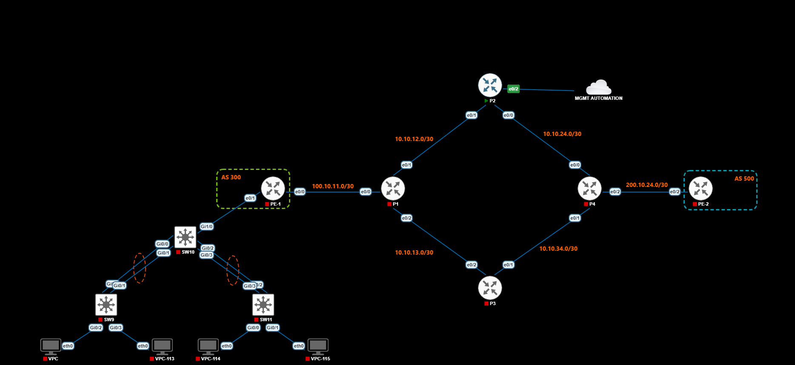

# NetAuto

API FastAPI que executa comandos `show` em roteadores via SSH (Netmiko) e exibe a saída em uma página HTML.

## Requisitos
- Python 3.10+
- Acesso SSH a um dispositivo de rede

## Instalação
```bash
python -m venv .venv
.venv\Scripts\activate        # Windows
pip install -r requirements.txt
# opcional: cp .env.example .env para sobrescrever os valores do laboratório
```

## Execução
```bash
cd src
python main.py
```
Acesse `http://localhost:8000/show-comands`.

## Endpoints
| Rota | Descrição |
|------|-----------|
| `GET /` | Health check |
| `GET /show-comands` | Executa `sh clock` e `sh ip int br` e renderiza o resultado |

## Laboratório de teste (PNETLab)



| Link | Rede |
|------|------|
| PE-1 (AS 300) ↔ P1 | `100.10.11.0/30` |
| P1 ↔ P2 | `10.10.12.0/30` |
| P1 ↔ P3 | `10.10.13.0/30` |
| P2 ↔ P4 | `10.10.24.0/30` |
| P3 ↔ P4 | `10.10.34.0/30` |
| P4 ↔ PE-2 (AS 500) | `200.10.24.0/30` |

O P2 possui a interface `e0/2` conectada à nuvem **MGMT AUTOMATION**; é por ela que a API alcança o dispositivo (`10.255.0.2`).

## Configuração
Os padrões (`10.255.0.2`, `cisco/cisco`) são de um laboratório. Para outro dispositivo, copie `.env.example` para `.env` e ajuste.
